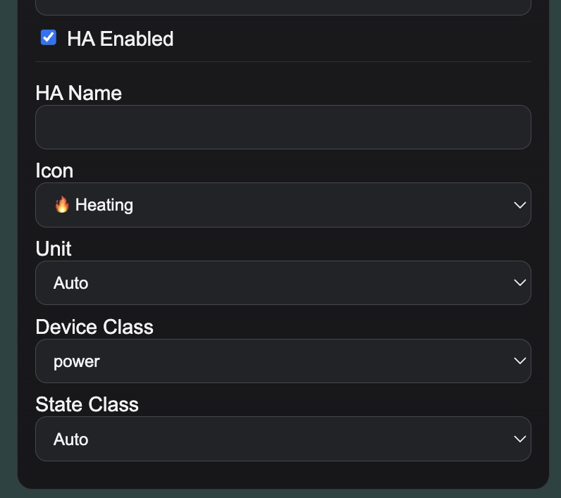

# Home Assistant Integration

> **Navigation:** [📖 Startseite](../README.md) | [📲 Installation](installation.md) | [🖥️ Webinterface](webinterface.md) | [📍 ROI Konfiguration](roi.md) | [🎛️ Segment-Profile](seg_profiles.md) | → **🤖 Home Assistant** | [🧪 Test & Debug](test_debug.md)

---

## HA Auto Discovery

Wenn **HA Enabled** aktiviert ist, wird die erkannte Information automatisch für **Home Assistant** bereitgestellt.

Ein ROI kann damit direkt in **Home Assistant** integriert werden.




Folgende Parameter können konfiguriert werden:

**HA Name**
Name der Entität in Home Assistant.

**Icon**
Auswahl eines passenden Symbols für die Darstellung in der Oberfläche.

**Unit**
Einheit des Messwerts, z. B.:

* °C
* %
* W
* kWh

**Device Class**
Definiert die Art des Sensors für Home Assistant, z. B.:

* temperature
* power
* energy
* timestamp

In vielen Fällen kann hier auch **Auto** verwendet werden.

**State Class**
Bestimmt, wie Home Assistant den Wert verarbeitet, z. B.:

* measurement
* total
* total_increasing

Auch hier kann häufig **Auto** verwendet werden.

Nach Aktivierung erscheinen die Sensoren automatisch über **MQTT Auto Discovery** in Home Assistant.

### Display aus / Erkennungsfehler

Sobald mindestens eine 7-Segment-ROI konfiguriert ist, wird zusätzlich der Binärsensor **Display Active** angelegt.
Er ist `ON`, solange mindestens eine 7-Segment-ROI einen Wert liefert.
Sind alle 7-Segment-ROIs leer (z. B. Pumpe aus, Display dunkel), meldet er `OFF` und alle Zahlenwerte wechseln auf `unknown`.
So landen keine veralteten Werte in Energie- oder Verbrauchsberechnungen.

Wird nur ein Teil der ROIs nicht erkannt, entscheidet die Option **Hold last valid value per ROI on recognition errors** im MQTT-Bereich:
Entweder wird für diese ROI der letzte gültige Wert gehalten oder sie wird als `unknown` gemeldet.
Die übrigen ROIs werden in beiden Fällen normal aktualisiert.
Das Feld `valid` im Payload ist nur dann `true`, wenn in der aktuellen Auswertung alle ROIs erkannt wurden.

Beispiel-Payload bei ausgeschaltetem Display:

```json
{"valid":false,"K_02_flow_raw":null,"K_02_symbol_1":false,"K_02_symbol_2":false,"K_02_power_raw":null,"display_active":false}
```

---

## Mehrere Geräte am selben Broker

Mehrere Display-Reader-Instanzen können gleichzeitig am selben MQTT-Broker und denselben Home Assistant betrieben werden.

### Automatische Gerätetrennung

Jedes Gerät erhält beim ersten Start eine **eindeutige Hardware-ID**, die in `/device_uid.txt` auf dem internen Flash gespeichert wird. Diese ID ist:

- unabhängig von der MAC-Adresse (relevant bei Klon-Hardware mit identischer MAC)
- unabhängig von der gespeicherten Konfiguration
- persistent über Neustarts und Firmware-Updates

Die ID bestimmt automatisch:
- den MQTT-Topic (`heatpump/display_reader_<uid>/state`)
- den WLAN-Hostnamen (`display-reader-<uid>`)
- die HA-Entity-IDs und die Gerätezuordnung in Home Assistant

### Config-Import bei Mehrfachinstallationen

Die empfohlene Vorgehensweise für mehrere Geräte mit gleicher Display-Konfiguration:

1. Gerät 1 vollständig konfigurieren und testen
2. Konfiguration über [Export/Import](webinterface.md#12--konfiguration-exportimport) auf Gerät 2 übertragen
3. Gerätespezifische Felder (Topic, Hostname, Device ID) werden beim Import **automatisch zurückgesetzt** — kein manueller Eingriff nötig
4. Optional: **Device Name** unter [MQTT → HA-Discovery](webinterface.md#3--mqtt-konfiguration) individuell benennen und **Save Config** drücken

In Home Assistant erscheinen beide Geräte als **separate Geräte** mit je eigenen Entities — auch wenn ROI-IDs und Konfiguration identisch sind.

---

[⬆️ Nach oben](#home-assistant-integration)

> 📷 Alle Screenshots entstanden im Zusammenspiel mit einer **Buderus WPT260.4 AS** (Logatherm Warmwasser-Wärmepumpe).
