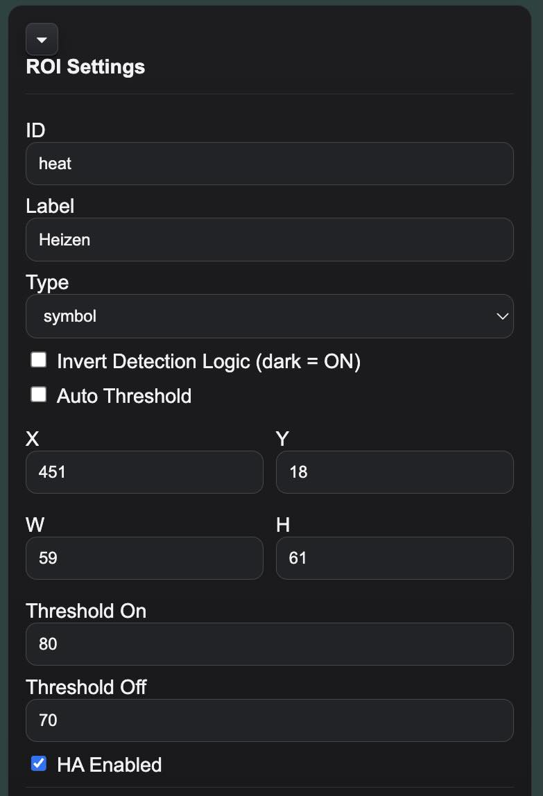
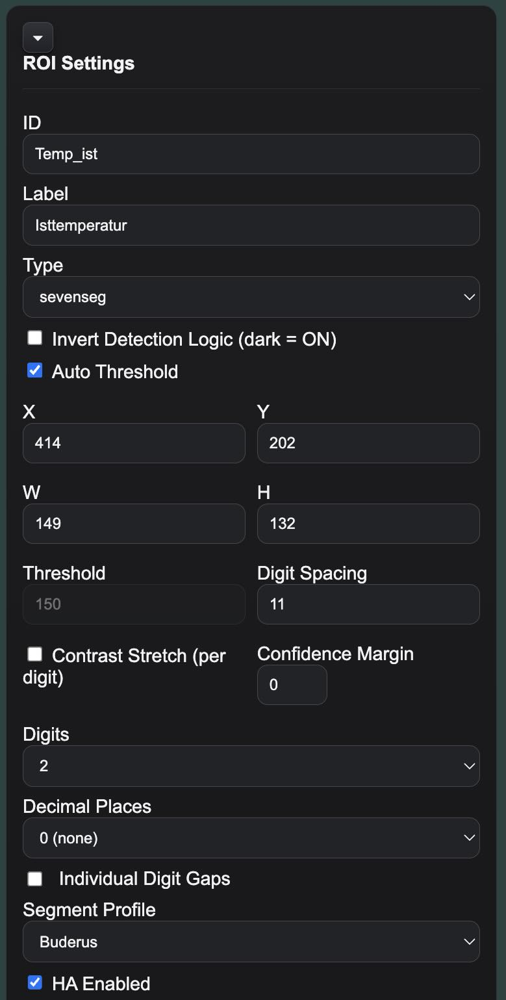

# Regions of Interest (ROI)

> **Navigation:** [📖 Startseite](../README.md) | [📲 Installation](installation.md) | [🖥️ Webinterface](webinterface.md) | → **📍 ROI Konfiguration** | [🎛️ Segment-Profile](seg_profiles.md) | [🤖 Home Assistant](homeassistant.md) | [🧪 Test & Debug](test_debug.md)

---

Regions of Interest (ROI) definieren die **Bildbereiche**, die das System auswertet. Für jede Anzeige oder jedes Symbol auf dem Display wird eine eigene ROI angelegt.

ROIs werden im Webinterface unter den Bereichen [Kameravorschau](webinterface.md#6--kameravorschau) und [ROI Liste](webinterface.md#7--roi-liste) verwaltet.

Es gibt zwei ROI-Typen:

| Typ | Verwendung |
|-----|-----------|
| [Symbol ROI](#symbol-roi) | Erkennt Ein/Aus-Zustände (z. B. Symbole, Lämpchen) |
| [Seven-Segment ROI](#seven-segment-roi) | Erkennt Zahlenwerte auf 7-Segment Anzeigen |

---

## Symbol ROI



Eine Symbol-ROI bewertet die **Durchschnittshelligkeit** in einem definierten Bildbereich und leitet daraus einen binären Zustand (aktiv/inaktiv) ab.

Typische Anwendungen:

- Betriebsstatus (Ein/Aus)
- Fehleranzeige
- Warnsymbole
- Hintergrundbeleuchtung eines Segments

### Parameter

**ID**
Eindeutiger technischer Name der ROI.
Wird als MQTT-Key und als Basis für die Home Assistant Entity-ID verwendet.
Nur Buchstaben, Zahlen und Unterstriche empfohlen.

**Label**
Anzeigename im Webinterface.

**X / Y / W / H**
Position und Größe des ausgewerteten Bildbereichs in Pixeln.
Kann im Kamerabild per Maus verschoben und skaliert werden.

**Threshold On**
Helligkeitswert (0–255), ab dem das Symbol als **aktiv** gilt.
Wenn der Durchschnittswert des Bereichs diesen Wert erreicht oder überschreitet, wird der Zustand auf `true` gesetzt.

**Threshold Off**
Helligkeitswert (0–255), unter dem das Symbol als **inaktiv** gilt.
Der Bereich zwischen Threshold Off und Threshold On bildet eine **Hysterese**, die kurze Zustandsschwankungen verhindert.

**Invert Detection Logic**
Kehrt die Erkennung um.
Nützlich wenn ein dunkles Symbol den aktiven Zustand darstellt (z. B. dunkles Icon auf hellem Hintergrund).

**Auto Threshold**
Berechnet den Schwellwert automatisch aus dem Bildinhalt.
Funktioniert zuverlässig bei bimodalen Helligkeitsverteilungen (helle Segmente auf dunklem Hintergrund oder umgekehrt).
Bei aktiviertem Auto Threshold werden die manuellen Threshold-Werte ignoriert.

---

## Seven-Segment ROI



Eine Seven-Segment ROI erkennt **numerische Werte** auf 7-Segment Anzeigen. Der definierte Bildbereich wird automatisch in einzelne Ziffernbereiche aufgeteilt, die jeweils auf ihre 7 Segmente (a–g) analysiert werden.

### Parameter

**ID**
Eindeutiger technischer Name der ROI.
Wird als MQTT-Key und als Basis für die Home Assistant Entity-ID verwendet.

**Label**
Anzeigename im Webinterface.

**X / Y / W / H**
Position und Größe des gesamten ROI-Bereichs (alle Ziffern zusammen) in Pixeln.

**Digits**
Anzahl der Ziffern auf der Anzeige.

**Digit Spacing**
Gleichmäßiger Abstand zwischen den Ziffern in Pixeln.
Wird für alle Lücken zwischen den Ziffern identisch angewendet.
Für unterschiedliche Abstände zwischen einzelnen Ziffern siehe [Individual Digit Gaps](#individual-digit-gaps).

**Decimal Places**
Anzahl der Nachkommastellen.

- `0` → Ganzzahl (z. B. `42`)
- `1` → eine Nachkommastelle (z. B. `4.2`)
- `2` → zwei Nachkommastellen (z. B. `0.42`)

**Threshold**
Helligkeitsschwelle zur Erkennung aktiver Segmente (0–255).
Segmente mit einem Durchschnittswert oberhalb des Schwellwerts gelten als eingeschaltet.

**Segment Profile**
Auswahl des Segment-Layouts.
Das Profil definiert, wo genau jedes der 7 Segmente (a–g) innerhalb einer Ziffer gemessen wird.
Standard-Profil deckt die meisten gängigen 7-Segment Displays ab.
Eigene Profile können im [Segment/Profiles Editor](webinterface.md#10--segmentprofiles-editor) erstellt werden.

**Invert Logic**
Kehrt die Segmenterkennung um.
Verwenden wenn die Segmente **dunkler** als der Hintergrund sind (z. B. LCD ohne Hintergrundbeleuchtung, schwarze Segmente auf hellem Grund).

**Auto Threshold**
Berechnet den Schwellwert automatisch — empfohlen bei schwankenden Lichtverhältnissen oder reflektiven LCDs.
Bei aktiviertem Auto Threshold wird der manuelle Threshold-Wert ignoriert.

Das System verwendet einen **per-Ziffer Gap-Threshold**: Die 7 Segment-Helligkeitswerte jeder einzelnen Ziffer werden sortiert, und der größte Helligkeitssprung zwischen benachbarten Werten bestimmt den Trennwert. Dadurch hat jede Ziffer ihren eigenen, optimal angepassten Schwellwert — auch wenn benachbarte Stellen unterschiedlich beleuchtet sind.

Zusätzlich wird bei aktiviertem Auto Threshold ein **Fuzzy-Match** (Hamming-Distanz 1) verwendet: Wenn das erkannte Bitmuster keinem gültigen Digit exakt entspricht, aber sich in genau einem Segment unterscheidet, wird das wahrscheinlichste Digit zurückgegeben.

**Stretch Contrast**
Normalisiert den Helligkeitsbereich des ROI-Bereichs vor der Auswertung.
Der dunkelste Pixel wird auf 0, der hellste auf 255 gesetzt.
Verbessert die Erkennungsrate bei geringem Bildkontrast.

**Confidence Margin**
Unsicherheitsbereich um den Schwellwert in Helligkeitsstufen.
Segmente deren Helligkeit innerhalb von ± Margin um den Schwellwert liegt, werden als **unsicher** eingestuft.
Liegt ein Segment im unsicheren Bereich, wird die gesamte Ziffer als nicht erkennbar gewertet.

Empfohlene Werte:
- `0` → empfohlen bei aktiviertem **Auto Threshold** (Gap-Threshold + Fuzzy-Match übernehmen die Toleranz)
- `5–15` → sinnvoll bei **manuellem Threshold** mit stabilen Lichtverhältnissen
- `> 20` → nur bei sehr schlechten Lichtverhältnissen mit manuellem Threshold

---

### Individual Digit Gaps

Wenn die Abstände zwischen den einzelnen Ziffern **unterschiedlich** sind, können diese über die Checkbox **"Individual Digit Gaps"** in den ROI-Einstellungen separat konfiguriert werden.

Nach dem Aktivieren erscheinen individuelle Eingabefelder für jede Lücke zwischen den Ziffern. Die Anzahl der Felder entspricht immer `Digits - 1`.

Ist die Checkbox deaktiviert, wird der einheitliche **Digit Spacing** Wert für alle Lücken verwendet.

Beispiel für eine 4-stellige Anzeige mit ungleichmäßigen Abständen:

```json
"gaps": [4, 12, 4]
```

Hier ist der Abstand zwischen Ziffer 1–2 und 3–4 je 4 Pixel, zwischen Ziffer 2–3 (z. B. ein Trennzeichen) 12 Pixel.

Ist das `gaps`-Array leer oder nicht vollständig befüllt, wird der einheitliche **Digit Spacing** Wert für alle Lücken verwendet.

---

## Wechselanzeige (Multiplex-Modus)

> ⚠️ **Experimentell:** Dieser Modus ist bisher nicht mit einem echten Gerät mit Wechselanzeige getestet. Rückmeldungen (Erfolg oder Probleme) bitte als GitHub-Issue.

Manche Geräte zeigen mehrere Werte abwechselnd im selben Ziffernfeld an und kennzeichnen den aktuellen Wert mit einem Einheitensymbol.
Beispiel: Laut Herstellerhandbuch wechseln neuere Generationen der Wilo Yonos PICO plus zwischen Leistung (W) und Durchfluss (m³/h). Ältere Generationen zeigen nur die Leistung an.

Einrichtung:

1. Im MQTT-Bereich **Capture Mode** auf **Multiplex** stellen und das **Display Change Interval** eintragen.
2. Für jede Einheit eine **Symbol-ROI** anlegen (z. B. `sym_w` über dem „W“, `sym_flow` über „m³/h“).
3. Für jeden Wert eine eigene **Seven-Segment-ROI** anlegen. Die ROIs dürfen sich überlappen, z. B. `power` mit 0 Nachkommastellen und `flow` mit 1 Nachkommastelle.
4. Bei jeder Seven-Segment-ROI unter **Valid only if symbol is ON** das passende Symbol wählen.

Ablauf eines Messzyklus:

- Es wird etwa alle 300 ms ein Bild ausgewertet.
- Pro Bild wird zuerst geprüft, welches Gate-Symbol leuchtet. Nur die zugehörigen ROIs werden aus diesem Bild übernommen. Bilder, in denen mehrere Gate-Symbole leuchten (Umschaltmoment), werden für Gate-ROIs verworfen.
- Ein Wert gilt als erkannt, sobald er in zwei Bildern übereinstimmt.
- Der Zyklus endet, wenn alle Werte erkannt sind, spätestens aber nach *(Anzahl Anzeigen + 1) × Display Change Interval*.
- Wird nach einer Anzeigedauer + 1 s gar nichts erkannt, gilt das Display als aus und der Zyklus endet sofort.
- Nicht erkannte Werte werden je nach Einstellung **Hold last valid value per ROI** gehalten oder als `unknown` gemeldet.

Im MQTT-Payload melden Gate-Symbole im Multiplex-Modus, ob ihre Anzeige im Zyklus gesehen wurde. Andere Symbole melden ihren Zustand im letzten Bild.

Einschränkung: Zwei Anzeigen mit identischem Symbol lassen sich nicht unterscheiden. Jede Anzeige braucht ein eigenes Symbol.

---

## Mindestanforderungen an die ROI-Größe

Damit die 7-Segment Erkennung zuverlässig funktioniert, muss die ROI eine Mindestgröße einhalten:

| Parameter | Mindestwert |
|-----------|-------------|
| Ziffer Breite | 8 Pixel |
| ROI Höhe | 20 Pixel |

Wird die Mindestgröße unterschritten, meldet das System einen Geometriefehler und liefert keinen Wert.
Die Mindestmaße sind in der Debug-Ausgabe ([Status & Results](webinterface.md#11--status--results)) nachvollziehbar.

---

[⬆️ Nach oben](#regions-of-interest-roi)

> 📷 Alle Screenshots entstanden im Zusammenspiel mit einer **Buderus WPT260.4 AS** (Logatherm Warmwasser-Wärmepumpe).
